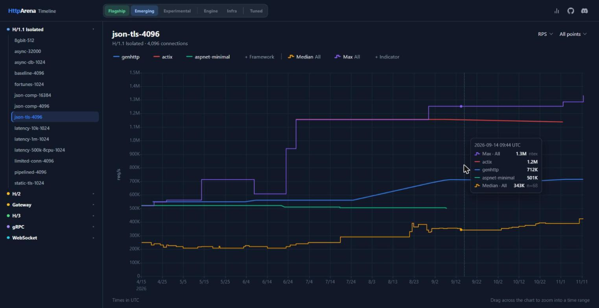

# HttpArena Timeline

A historical view of [HTTP Arena](https://www.http-arena.com) benchmark results, allowing framework maintainers and users to track performance changes over time.

**[Open the Timeline →](https://timeline.http-arena.com/)**

---



---

## What is this?

[HTTP Arena](https://www.http-arena.com) runs regular benchmarks across dozens of web frameworks and languages, measuring throughput, latency, CPU usage, memory consumption, and more. The results on the site reflect only the most recent run. This project fills the gap by recording every benchmark run into a time series, making it possible to answer questions like:

- Did this release improve throughput?
- When did latency regress, and by how much?
- How does a framework trend compared to its historical baseline?
- How does it compare to the field: the median, average, best or worst of all frameworks, or of its own language?

## How it works

The project has two components:

**Import process** — a C# tool that walks the git history of the [HTTP Arena repository](https://github.com/danielHalan/HttpArena) and extracts benchmark result files from each relevant commit. Results are written as static JSON files under `data/<framework>/<test>-<concurrency>.json`, deduplicated so that only runs with a meaningful RPS change (or a gap of 7+ days) are recorded.

It also records, per test, how the whole field of results changed day by day (`data/indicators/<test>-<concurrency>.json`). From it the SPA computes **indicators**: the median, average, min and max of every metric across all frameworks or per language, for whatever HttpArena type filter is selected (flagship, emerging, experimental, engine, infra, tuned; classification as on HttpArena's main today).

**SPA** — a client-side web application that reads the static JSON files and renders interactive time-series graphs. Select a test and one or more frameworks, add indicators to compare against, filter by HttpArena's framework types like on the leaderboard, and explore how any metric has evolved over time.

Because everything is static JSON served from GitHub Pages, no backend infrastructure is required.

## Data format

Each timeline file has the following structure:

```json
{
  "data": [
    ["2025-01-01T10:22:00Z", { "rps": 43000, "avg_latency_ms": 1.2, "p99_latency_ms": 3.5, ... }],
    ["2025-01-08T10:22:00Z", { "rps": 43500, "avg_latency_ms": 1.1, "p99_latency_ms": 3.3, ... }]
  ]
}
```

An `index.json` at the root of `data/` lists all available frameworks (with language, HttpArena type and tuned flag), tests and indicator scopes for the SPA to enumerate.

Indicator files are field logs: one entry per UTC day on which the test's results were touched, holding the rows set that day (`[frameworkIndex, value per metric...]`) and the frameworks removed that day. The SPA replays a log and aggregates whichever frameworks the type filter and scope select.

```json
{
  "metrics": ["rps", "avg_latency_ms", ...],
  "frameworks": ["actix", "h2o", ...],
  "days": [
    ["2026-08-15T18:22:00Z", [[0, 1456838, 2.73, ...], [1, 2210331, 1.9, ...]], [5]]
  ]
}
```

## Running the import locally

```bash
dotnet run --project src/Importer/Importer.csproj [<repo-path> [<output-path> [<starting-commit>]]]
```

Defaults point to `../HttpArena` as the source repository and `./data` as the output directory.

## License

MIT
